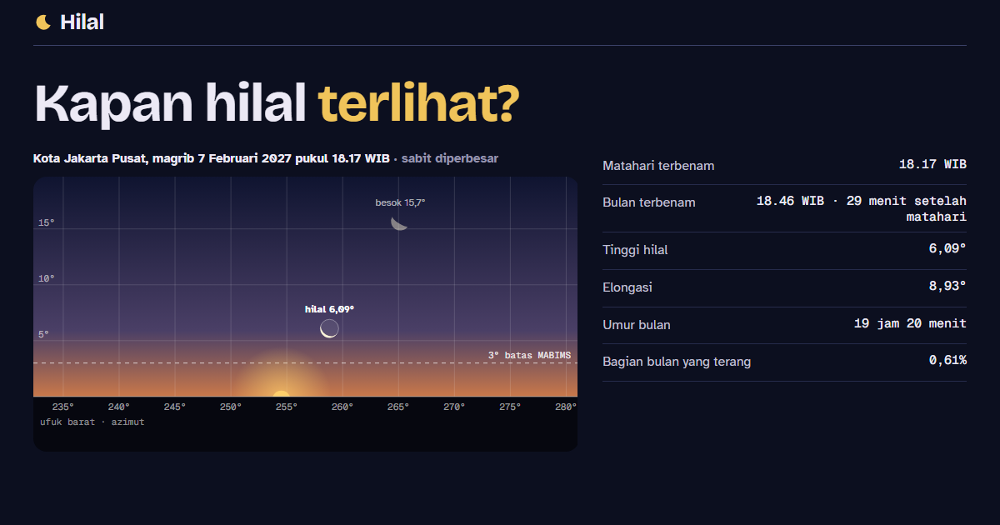

# Hilal



**[Buka Hilal](https://hilal-id.vercel.app)**

Seberapa tinggi hilal di daerahmu saat magrib? Hilal menghitung posisi bulan dan matahari
setelah setiap ijtimak untuk 514 kabupaten/kota, lalu membandingkannya dengan dua kriteria
yang dikenal di Indonesia: **MABIMS** (tinggi ≥ 3°, elongasi ≥ 6,4°) dan **wujudul hilal**
(bulan terbenam sesudah matahari).

- **Dua belas bulan ke depan**, dengan bulan penting (Ramadan, Syawal, Zulhijah) ditandai.
  Untuk tiap bulan: waktu ijtimak, berapa daerah yang memenuhi tiap kriteria, dan perkiraan
  tanggal 1 serta hari rayanya.
- **Peta tinggi atau elongasi hilal** di 514 kabupaten/kota saat magrib.
- **Langit barat saat magrib** di daerahmu: posisi matahari, hilal, dan hilal keesokan
  harinya, dengan garis batas 3°.
- **Tabel dan grafik sebaran** yang memperlihatkan kapan kedua kriteria sepakat dan kapan
  tidak, bersama kasus nyata ketika awal bulan memang berbeda.
- Tautan per bulan dan daerah (`#bulan=ramadan-1448&daerah=kota-jakarta-pusat`). Mode gelap
  mengikuti sistem.

## Perhitungan

Posisi bulan dan matahari memakai [Astronomy Engine](https://github.com/cosinekitty/astronomy)
(Don Cross, MIT). Tinggi hilal adalah tinggi toposentrik pusat bulan tanpa refraksi saat
matahari terbenam; elongasi adalah jarak sudut geosentrik bulan–matahari. Pengamatan dilakukan
pada magrib tanggal ijtimak, atau magrib berikutnya bila ijtimak terjadi sesudah 18.00 WIB.
Perkiraan tanggal 1 memakai satu kesatuan wilayah Indonesia.

Hasilnya diuji terhadap penetapan yang sudah terjadi (`npm test`):

| Bulan | Hasil hitungan | Kenyataan |
|---|---|---|
| Ramadan 1444 | hilal 8,6°, kedua kriteria terpenuhi | serentak 23 Maret 2023 |
| Syawal 1444 | hilal 2,1°, MABIMS tidak terpenuhi | 21 April (Muhammadiyah), 22 April 2023 (pemerintah) |
| Zulhijah 1444 | MABIMS tidak terpenuhi | Iduladha 28 dan 29 Juni 2023 |
| Ramadan 1445 | hilal 0,4°, MABIMS tidak terpenuhi | 11 Maret (Muhammadiyah), 12 Maret 2024 (pemerintah) |
| Syawal 1445 | hilal 7,5°, kedua kriteria terpenuhi | serentak 10 April 2024 |

Muhammadiyah kini memakai Kalender Hijriah Global Tunggal, yang tidak dihitung di sini.
**Ini hasil hitungan, bukan penetapan.** Awal bulan resmi ditetapkan Kementerian Agama melalui
sidang isbat, dan ormas Islam menerbitkan ketetapannya sendiri.

Lokasi tiap daerah adalah titik tengah wilayahnya (geoBoundaries: BPS, WFP, OCHA ROAP,
CC BY 3.0 IGO).

## Menjalankan

```
npm install
npm run dev
npm test        # ijtimak, penamaan bulan, kasus sejarah (vitest)
npm run build
```

Vite + TypeScript, tanpa framework UI; peta dengan d3-geo dan topojson-client. Peta warna
tinggi hilal divergen di 0°, divalidasi untuk latar terang dan gelap.
